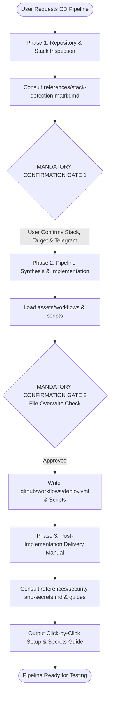
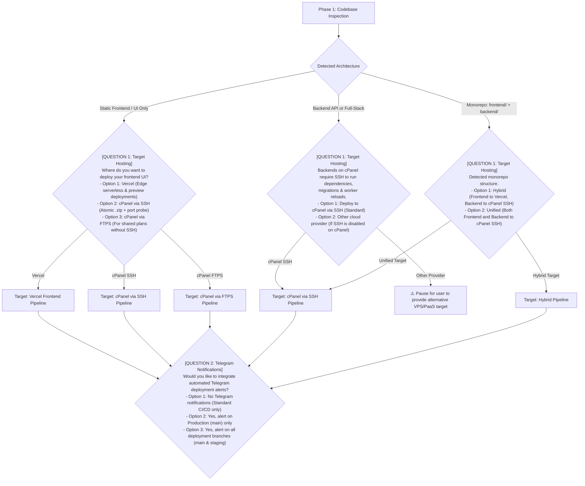

# DevOps Deployment Skill

An enterprise-grade, modular Continuous Deployment (CD) skill for AI coding agents. This skill enables agents to inspect any application repository, detect its architecture and toolchain, execute mandatory confirmation gates, generate hardened GitHub Actions deployment pipelines for **cPanel** (via SSH or FTPS) and **Vercel**, and provide a complete post-implementation operational manual with optional Telegram deployment notifications.

---

## Progressive Disclosure & Execution Model

This skill is designed under the **Agent Skills specification** three-tier progressive disclosure model:
1. **Discovery (Startup):** The agent loads metadata (`name` and `description`) to match user deployment requests.
2. **Activation (This Document):** When triggered, the agent reads this `SKILL.md` to guide repository inspection, enforce confirmation gates, and orchestrate pipeline design.
3. **Execution (Deep Linking):** The agent loads specialized reference guides from `references/`, executes or copies scripts from `scripts/`, and instantiates workflow templates from `assets/workflows/` only as needed for the target architecture.

```
devops-deployment/
├── SKILL.md                          # Master orchestration & confirmation gates (this file)
├── references/                       # Deep technical references & manuals
│   ├── stack-detection-matrix.md     # Inspection heuristics for runtimes, frameworks & monorepos
│   ├── cpanel-ssh-guide.md           # SSH keys, port probing, atomic sync & worker recycling
│   ├── cpanel-ftps-guide.md          # FTPS configuration, chroot directory traps & action tuning
│   ├── vercel-guide.md               # Vercel CLI prebuilt flow, project linking & token security
│   ├── telegram-notifications.md     # BotFather, topic/thread routing, HTML escaping & lifecycle
│   ├── security-and-secrets.md       # GitHub Secrets, Environments, token permissions & masking
│   └── troubleshooting-manual.md     # Root cause analysis & fixes for top deployment errors
├── scripts/                          # Hardened POSIX helper scripts
│   ├── probe-ssh-port.sh             # Dynamic SSH port probing (configured, 22, 1219, 2222)
│   ├── normalize-ssh-key.sh          # OpenSSH key validation & passphrase stripping
│   ├── cpanel-deploy-remote.sh       # Atomic remote extraction, state preservation & rollback
│   └── telegram-notify.sh            # Telegram Bot API notification engine with HTML formatting
└── assets/                           # Production-tested GitHub Actions workflow & config templates
    ├── workflows/
    │   ├── deploy-cpanel-ssh.yml     # cPanel SSH deployment workflow
    │   ├── deploy-cpanel-ftps.yml    # cPanel FTPS deployment workflow
    │   ├── deploy-vercel.yml         # Vercel frontend deployment workflow
    │   └── deploy-hybrid-monorepo.yml# Monorepo (Vercel UI + cPanel Backend)
    └── configs/
        ├── htaccess-spa.txt          # Production Apache/LiteSpeed SPA rewrite template
        └── vercel-spa.json           # Production Vercel SPA rewrite configuration
```

---

## Core Operational Workflow

When activated, the agent MUST follow these three consecutive phases without skipping steps:



---

## Phase 1: Repository Inspection & Stack Detection

Before generating or modifying any file, thoroughly inspect the repository to classify:

1. **Architecture Classification:**
   - **Static Frontend / SPA:** React, Vue, Svelte, Vite, Astro, Nuxt (static), Next.js (export), or HTML5/CSS.
   - **Backend API or Full-Stack Application:** Node.js (Express, Nest, Fastify), Python (Django, FastAPI, Flask), PHP (Laravel, Symfony, WordPress), Go, or Ruby on Rails.
   - **Monorepo / Multi-Service Structure:** Multiple subdirectories (e.g., `client/` and `server/`, `frontend/` and `backend/`, `apps/web` and `apps/api`), workspace manifests (`pnpm-workspace.yaml`, npm/yarn `workspaces`, Turborepo, Lerna).
2. **Tooling, Package Managers & Lockfiles:**
   - Detect lockfiles: `package-lock.json` (npm), `pnpm-lock.yaml` (pnpm), `yarn.lock` (yarn), `bun.lockb` (bun), `requirements.txt` / `pyproject.toml` / `Pipfile` / `poetry.lock` (pip/poetry/uv), `composer.lock` (composer), `go.mod` (go).
3. **Build Commands & Artifact Paths:**
   - Build scripts (`npm run build`, `python manage.py collectstatic`, etc.).
   - Build output directories (`dist/`, `build/`, `out/`, `.next/standalone`, `public/`).
4. **Quality Gates:**
   - Linting commands (`npm run lint`, `flake8`, `ruff`, `phpstan`).
   - Type-checking (`tsc --noEmit`, `mypy`).
   - Test suites (`npm test`, `pytest`, `php artisan test`, `go test ./...`).
5. **Existing CI/CD & Deployments:**
   - Check `.github/workflows/` for existing workflows. Note existing triggers, environments, and secrets to avoid breaking working pipelines.

> [!TIP]
> For complete detection heuristics and regex rules across all languages and frameworks, consult [stack-detection-matrix.md](file:///references/stack-detection-matrix.md).

---

## MANDATORY CONFIRMATION GATE 1: Stack & Target Confirmation

> [!IMPORTANT]
> **MANDATORY HUMAN-IN-THE-LOOP CONFIRMATION RULE:**
> An AI agent can inspect code, package managers, and build artifacts, but **cannot inspect external hosting infrastructure, account privileges, or provider capabilities**.
> Whenever more than one deployment target exists, or when key infrastructure choices cannot be inspected from code, the agent **MUST STOP AND FORCE AN INTERACTIVE CONFIRMATION** in a single consolidated turn.
> Do NOT write, modify, or delete any workflow or script files before receiving explicit user answers.

### Streamlined Decision Tree (Tree of Choice)



---

### Forced Question Dialogue Templates (Single-Turn Resolution)

The agent outputs its inspection findings and immediately presents the applicable Target Question and Notification Question in **one single interactive message**:

#### 1. Inspection Summary Output (Always Output First)
```markdown
### 🔍 Repository Inspection Findings
- **Detected Architecture:** [Static Frontend UI / Full-Stack Application / Backend API / Monorepo]
- **Language & Runtime:** [e.g. Node.js 20 / Python 3.11 / PHP 8.2]
- **Framework:** [e.g. Vite (React) / Next.js / Laravel / FastAPI]
- **Package Manager:** [e.g. npm / pnpm / yarn / pip / composer]
- **Quality Gates:** [e.g. npm run lint, npm test]
- **Build Output Directory:** [e.g. dist/ / build/ / public/]
```

#### 2. Question 1 (Select Target based on Detected Architecture):
- **If Static Frontend / UI Only is detected:**
  > **Question 1 (Target Hosting):**
  > "Where would you like to deploy your frontend UI?
  > - **[Option 1] Vercel** *(Recommended for modern edge hosting: automatic staging previews, instant rollbacks, zero server setup)*.
  > - **[Option 2] cPanel via SSH** *(Recommended if hosting under an existing cPanel plan with SSH terminal access)*.
  > - **[Option 3] cPanel via FTPS** *(For shared cPanel hosting plans where SSH terminal access is disabled)*."

- **If Backend API or Full-Stack Application is detected:**
  > **Question 1 (Target Hosting):**
  > "I detected a backend application. Backend runtimes on cPanel require SSH access to install packages, run database migrations, and reload worker processes.
  > - **[Option 1] Deploy to cPanel via SSH** *(Standard)*.
  > - **[Option 2] Cancel / Target alternative cloud provider** *(If SSH terminal access is unavailable on your cPanel account)*."

- **If Monorepo / Multi-Service (`frontend/` + `backend/`) is detected:**
  > **Question 1 (Target Hosting):**
  > "This repository contains both frontend and backend services. How would you like to deploy them?
  > - **[Option 1] Hybrid Deployment (Recommended)**: Deploy the frontend UI to Vercel and the backend API to cPanel via SSH.
  > - **[Option 2] Unified cPanel Deployment**: Deploy both frontend and backend to cPanel via SSH."

#### 3. Question 2 (Telegram Deployment Alerts — for All Targets):
> **Question 2 (Telegram Notifications):**
> "Would you like to integrate automated deployment notifications via Telegram?
> - **[Option 1] No Telegram notifications** *(Standard GitHub Actions execution)*.
> - **[Option 2] Yes, alert on Production (`main`) only**.
> - **[Option 3] Yes, alert on all deployment branches (`main` and `staging`)*."

**The agent MUST pause execution after presenting these two questions and wait for the user's explicit response before synthesizing any files.**

---

## Phase 2: Pipeline Architecture Synthesis & Implementation

Once the user confirms the target architecture and notification preference:

### Step 1: Select Delivery Mode & Workflow Template
The agent supports two delivery modes based on user preference or project structure:
- **Mode A: Zero-Clutter Mode (Single-File - Default):** Generates a completely self-contained `.github/workflows/deploy.yml`. Telegram curl notifications, port probing, key normalization, and remote server extraction run inline without adding auxiliary script files into the target repository.
- **Mode B: Companion Scripts Mode:** Bundles helper scripts from `scripts/` (`cpanel-deploy-remote.sh`, `telegram-notify.sh`) into target repo's `scripts/` directory for modular testing and complex lifecycle overrides.

Select the matching baseline template from `assets/workflows/`:
- **cPanel via SSH:** Use [deploy-cpanel-ssh.yml](file:///assets/workflows/deploy-cpanel-ssh.yml).
- **cPanel via FTPS:** Use [deploy-cpanel-ftps.yml](file:///assets/workflows/deploy-cpanel-ftps.yml).
- **Vercel Frontend:** Use [deploy-vercel.yml](file:///assets/workflows/deploy-vercel.yml).
- **Hybrid Monorepo:** Use [deploy-hybrid-monorepo.yml](file:///assets/workflows/deploy-hybrid-monorepo.yml).

### Step 2: Enforce Engineering Standards

1. **Trigger & Environment Binding:**
   - File path: `.github/workflows/deploy.yml`.
   - Triggers: Push to `main` (binds to GitHub Environment: `production`) and `staging` (binds to GitHub Environment: `staging`).
   - Always include `workflow_dispatch` for manual triggers.
   - Dynamic environment binding:
     ```yaml
     environment: ${{ github.ref_name == 'main' && 'production' || 'staging' }}
     ```
   - Concurrency lock (prevents race conditions and corrupted atomic releases):
     ```yaml
     concurrency:
       group: "deploy-${{ github.ref_name }}"
       cancel-in-progress: false
     ```
   - Least-privilege permissions:
     ```yaml
     permissions:
       contents: read
       pull-requests: write # only when Vercel preview commenting is needed
       deployments: write
     ```

2. **Quality Gates & Fail-Fast Builds:**
   - Run linter, type-check, and unit tests before packaging. Never deploy broken code.
   - Enable dependency caching (`actions/setup-node` with cache, `actions/setup-python` with cache).

3. **SSH Deployment Execution (cPanel SSH):**
   - Consult [cpanel-ssh-guide.md](file:///references/cpanel-ssh-guide.md) for server architecture details.
   - Port probing: dynamically test configured port, 22, 1219, and 2222 with connection timeouts ([probe-ssh-port.sh](file:///scripts/probe-ssh-port.sh)).
   - Key normalization: validate OpenSSH headers and strip passphrases non-interactively if supplied ([normalize-ssh-key.sh](file:///scripts/normalize-ssh-key.sh)).
   - Package release archive (`release-${{ github.sha }}.zip`), strictly excluding `.git`, `node_modules`, `.venv`, and temporary files.
   - Transfer release archive via `scp` to `~/$CPANEL_APP_DIR/incoming/`.
   - Execute deployment: either run [cpanel-deploy-remote.sh](file:///scripts/cpanel-deploy-remote.sh) or execute inline atomic sync commands.
   - Jailshell fallbacks: use Python `zipfile` fallback if `unzip` is missing, and `cp -rn` / `cp -rf` fallback if `rsync` is missing.
   - Ensure runtime state preservation: strictly exclude `.env`, SQLite databases (`*.db`, `*.sqlite*`), `uploads/`, `media/`, `storage/` from being overwritten.
   - Enforce file permissions: `755` for directories, `644` for files.
   - Recycle worker processes: `touch tmp/restart.txt` for LiteSpeed/Passenger.
   - Ensure SPA URL rewriting exists in `.htaccess` if serving client-side routing ([htaccess-spa.txt](file:///assets/configs/htaccess-spa.txt)).

4. **FTPS Deployment Execution (cPanel FTPS):**
   - Consult [cpanel-ftps-guide.md](file:///references/cpanel-ftps-guide.md).
   - Inject [htaccess-spa.txt](file:///assets/configs/htaccess-spa.txt) into build output directory for SPAs.
   - Deploy using `SamKirkland/FTP-Deploy-Action@v4.3.5` with `protocol: ftps`.
   - Set `dangerous-clean-slate: false` to protect server configuration and unmanaged files.
   - Set `server-dir: /` (relative to chrooted FTP account home).

5. **Vercel Deployment Execution (Vercel):**
   - Consult [vercel-guide.md](file:///references/vercel-guide.md).
   - If client-side routing SPA and no `vercel.json` exists, copy [vercel-spa.json](file:///assets/configs/vercel-spa.json).
   - Use official Vercel CLI with prebuilt assets:
     - `vercel pull --yes --environment=... --token=...`
     - `vercel build ... --token=...`
     - `vercel deploy --prebuilt ... --token=...`
   - Explicitly pass `VERCEL_ORG_ID: ${{ secrets.VERCEL_ORG_ID }}` and `VERCEL_PROJECT_ID: ${{ secrets.VERCEL_PROJECT_ID }}` in step environment.

6. **Telegram Notifications Integration (If Opted In):**
   - Consult [telegram-notifications.md](file:///references/telegram-notifications.md).
   - Implement the notification lifecycle matching the ForgeDocs card styling:
     - **On Start:** Send initial notification with header `🚀 <b>Deployment Started</b>`, blockquote containing `📦 Repository`, `🌿 Branch` with environment tag, `👤 Triggered By`, `📝 Commit` (hash + escaped subject), and footer link `🔗 <a href="..."><b>View Actions Run #... →</b></a>`. Save Telegram `message_id`.
     - **On Completion (always() condition):** Delete the initial message via its `message_id` and send a replacement message with final status (`✅ <b>Deployment Successful</b>`, `❌ <b>Deployment Failed</b>`, `⚠️ <b>Deployment Cancelled</b>`), execution duration (`⏱️ <b>Duration:</b> ...`), and direct log links (`🔗 <b>View Actions Run →</b>` or `🔗 <b>View Failure Logs →</b>`).
     - Use HTML formatting with safe entity escaping via [telegram-notify.sh](file:///scripts/telegram-notify.sh) or inline curl fallback.
     - Guard against failure: notification failure must NEVER fail the deployment job.

---

## MANDATORY CONFIRMATION GATE 2: File Creation & Overwrite Guard

> [!CAUTION]
> If a `.github/workflows/deploy.yml` or existing CI/CD file already exists in the repository, you MUST prompt the user for confirmation before overwriting or modifying it. Present a diff or clear explanation of proposed changes.

---

## Phase 3: Post-Implementation Delivery Manual

After generating the pipeline files, the agent MUST output a complete, beginner-friendly operational manual in markdown. Never terminate without providing this tailored guide.

The agent constructs the manual following this 5-part blueprint, loading exact definitions from the referenced guides:

### 1. Platform Credential & Account Setup
Provide click-by-click instructions tailored to the chosen architecture:
- **cPanel SSH:** Deep link to [cpanel-ssh-guide.md](file:///references/cpanel-ssh-guide.md) (*SSH Access > Manage SSH Keys > Generate > Authorize > View Private Key*).
- **cPanel FTPS:** Deep link to [cpanel-ftps-guide.md](file:///references/cpanel-ftps-guide.md) (*FTP Accounts > Add FTP Account*), highlighting the **directory trap** (erasing the default `public_html/username` subfolder to point directly to `public_html`).
- **Vercel:** Deep link to [vercel-guide.md](file:///references/vercel-guide.md) (*Tokens > Create Token*, Project Settings for `VERCEL_ORG_ID` and `VERCEL_PROJECT_ID`).
- **Telegram Bot:** Deep link to [telegram-notifications.md](file:///references/telegram-notifications.md) (*@BotFather* token, chat ID, and topic thread ID).

### 2. Tailored GitHub Secrets Table
Consult [security-and-secrets.md#a-repository-secrets-reference-matrix](file:///references/security-and-secrets.md) and render **ONLY** the secrets applicable to the user's selections:
- For cPanel SSH: `CPANEL_SSH_HOST`, `CPANEL_SSH_KEY`, optional `CPANEL_SSH_PORT`, conditional `CPANEL_SSH_PASSPHRASE`.
- For cPanel FTPS: `CPANEL_FTP_SERVER`, `CPANEL_FTP_USERNAME`, `CPANEL_FTP_PASSWORD`.
- For Vercel: `VERCEL_TOKEN`, `VERCEL_ORG_ID`, `VERCEL_PROJECT_ID`.
- If Telegram was enabled: `TELEGRAM_BOT_TOKEN`, `TELEGRAM_CHAT_ID`, optional `TELEGRAM_MESSAGE_THREAD_ID`.

### 3. Tailored GitHub Environment Variables Table
Consult [security-and-secrets.md#b-environment-variables-vars-configuration](file:///references/security-and-secrets.md) and render the environment variables table for `staging` and `production`:
- `CPANEL_USER` (cPanel SSH Linux account name).
- `CPANEL_APP_DIR` (destination folder relative to `/home/user/`, e.g., `staging.example.com` vs `public_html`).
- `CPANEL_FRONTEND_DOMAIN` (public domain for deployed UI).
- `CPANEL_API_DOMAIN` (target API endpoint — **omit if UI-only**).

### 4. Verification & Testing Procedure
Output step-by-step git commands to test staging first, inspect GitHub Actions logs, and promote to production:
```bash
# 1. Test Staging Deployment
git checkout -b staging && git push origin staging

# 2. Verify Execution in GitHub Actions Tab

# 3. Promote to Production
git checkout main && git merge staging && git push origin main
```

### 5. Quick Diagnostic & Troubleshooting Matrix
Present the immediate one-line diagnostic table from [troubleshooting-manual.md#1-quick-diagnostic-matrix](file:///references/troubleshooting-manual.md) covering:
1. Port 22 / 21 firewall timeouts.
2. `Permission denied (publickey)` unauthorized keys.
3. FTPS directory trap / blank site.
4. SPA 404 on browser refresh.
5. Server 500 / permission denied errors.

---

## Detailed References & Assets Directory

For complete implementation details, inspect the bundled resources:
- 📖 [Stack Detection Matrix](file:///references/stack-detection-matrix.md)
- 📖 [cPanel SSH Deployment Guide](file:///references/cpanel-ssh-guide.md)
- 📖 [cPanel FTPS Deployment Guide](file:///references/cpanel-ftps-guide.md)
- 📖 [Vercel Deployment Guide](file:///references/vercel-guide.md)
- 📖 [Telegram Notifications Guide](file:///references/telegram-notifications.md)
- 📖 [Security & Secrets Management](file:///references/security-and-secrets.md)
- 📖 [Troubleshooting Manual](file:///references/troubleshooting-manual.md)
- ⚙️ [SSH Port Prober Script](file:///scripts/probe-ssh-port.sh)
- ⚙️ [SSH Key Normalizer Script](file:///scripts/normalize-ssh-key.sh)
- ⚙️ [cPanel Remote Deploy Script](file:///scripts/cpanel-deploy-remote.sh)
- ⚙️ [Telegram Notification Engine](file:///scripts/telegram-notify.sh)
- 📄 [cPanel SSH Workflow Template](file:///assets/workflows/deploy-cpanel-ssh.yml)
- 📄 [cPanel FTPS Workflow Template](file:///assets/workflows/deploy-cpanel-ftps.yml)
- 📄 [Vercel Workflow Template](file:///assets/workflows/deploy-vercel.yml)
- 📄 [Hybrid Monorepo Workflow Template](file:///assets/workflows/deploy-hybrid-monorepo.yml)
- 📄 [SPA .htaccess Template](file:///assets/configs/htaccess-spa.txt)
- 📄 [SPA vercel.json Template](file:///assets/configs/vercel-spa.json)
