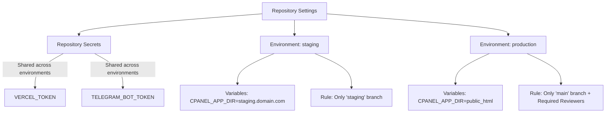

# Security, Secrets & Environments Reference Guide

This reference guide establishes the security architecture and governance standards for GitHub Actions deployment workflows configured by this skill.

---

## 1. Principle of Least Privilege (Token Permissions)

By default, GitHub Actions workflows run with elevated read/write token privileges unless explicitly restricted. Workflows generated by this skill must enforce strict `permissions` at the top level:

```yaml
permissions:
  contents: read        # Read access to repository code and commits
  deployments: write   # Required to update GitHub Deployment status APIs
  pull-requests: write # Only included when PR preview commenting is required
```

Never declare `permissions: write-all` or omit the permissions block.

---

## 2. GitHub Secrets vs GitHub Environments

To prevent accidental deployments and credential leakage, secrets and configuration variables must be partitioned by lifecycle stage:



### A. Repository Secrets Reference Matrix
Configure in *Repository Settings > Secrets and variables > Actions > Secrets*:

#### 1. If cPanel via SSH is selected:
| Secret Name | Requirement | Purpose / Content |
| :--- | :--- | :--- |
| `CPANEL_SSH_HOST` | **Required** | Server IP or hostname (e.g. `cpanel.yourdomain.com`). |
| `CPANEL_SSH_KEY` | **Required** | Full OpenSSH private key with `BEGIN/END` headers. |
| `CPANEL_SSH_PORT` | *Optional* | SSH port (defaults to 22; pipeline automatically probes 22, 1219, 2222). |
| `CPANEL_SSH_PASSPHRASE`| *Conditional* | Passphrase for private key (only required if a passphrase was set during key creation). |

#### 2. If cPanel via FTPS is selected:
| Secret Name | Requirement | Purpose / Content |
| :--- | :--- | :--- |
| `CPANEL_FTP_SERVER` | **Required** | FTPS hostname (e.g. `ftp.yourdomain.com`). |
| `CPANEL_FTP_USERNAME` | **Required** | Dedicated FTP username (e.g. `deployer@yourdomain.com`). |
| `CPANEL_FTP_PASSWORD` | **Required** | Strong password generated for the FTP account. |

#### 3. If Vercel is selected:
| Secret Name | Requirement | Purpose / Content |
| :--- | :--- | :--- |
| `VERCEL_TOKEN` | **Required** | Personal Access Token from Vercel Account Settings. |
| `VERCEL_ORG_ID` | **Required** | Team or user Account Identifier (`team_...` or `usr_...`). |
| `VERCEL_PROJECT_ID` | **Required** | Project Identifier from Vercel Project Settings (`prj_...`). |

#### 4. If Telegram Notifications are enabled:
| Secret Name | Requirement | Purpose / Content |
| :--- | :--- | :--- |
| `TELEGRAM_BOT_TOKEN` | **Required** | Bot API token from @BotFather (`123456:ABC-DEF...`). |
| `TELEGRAM_CHAT_ID` | **Required** | Group or supergroup Chat ID (e.g. `-1001234567890`). |
| `TELEGRAM_MESSAGE_THREAD_ID`| *Optional* | Forum Topic Thread ID (e.g. `42`). Omit for non-topic chats. |

---

### B. Environment Variables (`vars`) Configuration
Configure in *Repository Settings > Environments > [staging | production] > Environment variables*:

| Variable Name | Required For | Staging Example | Production Example | Description |
| :--- | :--- | :--- | :--- | :--- |
| `CPANEL_USER` | cPanel SSH | `cpaneluser` | `cpaneluser` | Linux account username on the cPanel server. |
| `CPANEL_APP_DIR` | cPanel (SSH & FTPS) | `staging.yourdomain.com` | `public_html` (or `appapi`) | Backend / Application directory relative to `$HOME/`. |
| `CPANEL_FRONTEND_DIR` | cPanel (Split Monorepo) | `staging.example.com` | `natran.koshomecafe.com` | Subdomain or document root directory relative to `$HOME/` for built SPA assets. |
| `CPANEL_FRONTEND_DOMAIN`| Frontend / Fullstack | `https://staging.yourdomain.com` | `https://yourdomain.com` | Public URL for notification cards and summary links. |
| `CPANEL_API_DOMAIN` | Backend / Hybrid API | `https://api-staging.yourdomain.com` | `https://api.yourdomain.com` | **Omit if UI-only**. Target API endpoint for backend services. |

> [!NOTE]
> **`CPANEL_FRONTEND_DIR` Scope & Fallback Rule:**
> - **Scope:** cPanel (SSH & FTPS) for Split Monorepos or separated frontend/backend structures.
> - **Purpose:** Subdomain or document root directory relative to `$HOME/` where built frontend SPA assets are deployed (e.g. `natran.koshomecafe.com` or `public_html/subdomain`).
> - **Automatic Fallback Rule:** If `CPANEL_FRONTEND_DIR` is not explicitly set, the deployment script automatically derives it by stripping `https://`, `http://`, trailing slashes, and ports from `CPANEL_FRONTEND_DOMAIN` (e.g. `https://natran.koshomecafe.com/` -> `natran.koshomecafe.com`).

> [!TIP]
> **Environment Flexibility:**
> For simple, single-environment, or test projects, users can set identical values across environments or configure `production` only. For full production isolation, distinct paths and domains should be set.

---

## 3. Secret Masking & Preventing Log Leakage

GitHub Actions automatically attempts to mask secret values defined in Secrets settings. However, mishandling secrets in custom shell scripts can expose them in console logs:

### Critical Security Rules for Scripts:
1. **Never use `set -x` (shell debug mode)** when processing credentials or private keys. `set -x` prints expanded shell variables directly to stdout.
2. **Explicit Masking:**
   When reading dynamic secrets or generating temporary credentials, register them with GitHub Actions masking:
   ```bash
   echo "::add-mask::$EXTRACTED_SECRET"
   ```
3. **Use Temporary Files with Restricted Permissions:**
   When writing SSH keys to disk in runner containers:
   ```bash
   SSH_KEY_FILE=$(mktemp)
   printf '%s\n' "$CPANEL_SSH_KEY" > "$SSH_KEY_FILE"
   chmod 600 "$SSH_KEY_FILE"
   trap 'rm -f "$SSH_KEY_FILE"' EXIT
   ```
   Always use a POSIX `trap` to ensure sensitive temporary files are wiped on exit, even if the workflow terminates abruptly.

---

## 4. Concurrency Locks & Race Condition Protection

To prevent concurrent pushes from clobbering an active deployment or corrupting shared files on cPanel:

```yaml
concurrency:
  group: "deploy-${{ github.ref_name }}"
  cancel-in-progress: false
```

- Setting `cancel-in-progress: false` ensures that if a deployment is currently running, the subsequent commit waits for it to complete cleanly, rather than killing the active transfer in the middle of writing files.
