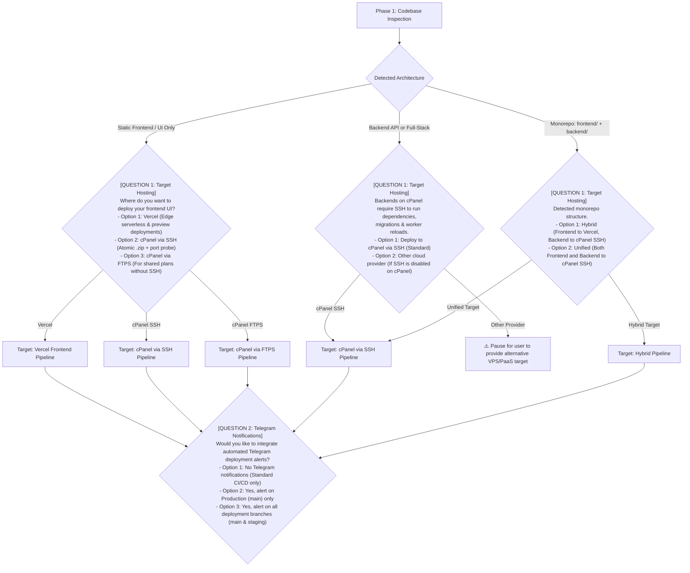

# Stack Detection Matrix & Inspection Heuristics

This reference guide provides comprehensive, deterministic rules for identifying project architectures, package managers, frameworks, build artifacts, and quality gates from a repository's file tree and manifests.

---

## 1. Architecture Classification Heuristics

The agent must inspect the repository root and first-level subdirectories to classify the overall project architecture into one of three primary topologies:

| Topology | Identification Criteria | Deployment Options |
| :--- | :--- | :--- |
| **Static Frontend / SPA** | Contains UI frameworks (`react`, `vue`, `svelte`, `vite`, `astro`, `next` with static export) with no persistent server runtime. | **cPanel via SSH**, **Vercel**, or **cPanel via FTPS** |
| **Backend API / Full-Stack** | Contains server runtimes (Node.js/Express/Nest, Python/Django/FastAPI, PHP/Laravel, Go) requiring persistent process or CGI/FastCGI/Passenger execution. | **cPanel via SSH** (FTP cannot run migrations, install packages, or manage processes) |
| **Monorepo / Multi-Service** | Contains multiple distinct service folders (e.g. `client/` & `server/`, `frontend/` & `backend/`, or workspace manifests like `pnpm-workspace.yaml`, `turbo.json`). | **Hybrid Target** (e.g., Frontend to Vercel, Backend to cPanel SSH) or **Full Monorepo to cPanel SSH** |

---

## 2. Runtime & Framework Detection Rules

### A. JavaScript / TypeScript Runtimes
- **Manifest File:** `package.json`
- **Lockfile & Package Manager Detection:**
  - `pnpm-lock.yaml` -> **pnpm** (`pnpm install --frozen-lockfile`)
  - `yarn.lock` -> **yarn** (`yarn install --immutable` or `yarn install --frozen-lockfile`)
  - `bun.lockb` or `bun.lock` -> **bun** (`bun install --frozen-lockfile`)
  - `package-lock.json` -> **npm** (`npm ci`)
- **Framework Signatures inside `package.json` (`dependencies` or `devDependencies`):**
  - **Next.js:** `"next": "..."`
    - Check `next.config.js` or `next.config.mjs`:
      - If `output: 'export'` -> Static HTML export (`out/` output folder).
      - If `output: 'standalone'` -> Standalone Node server (`.next/standalone` output folder).
      - If standard -> Serverless Next.js (ideal for **Vercel**).
  - **Vite:** `"vite": "..."`
    - Sub-frameworks: React (`@vitejs/plugin-react`), Vue (`@vitejs/plugin-vue`), Svelte (`@sveltejs/vite-plugin-svelte`).
    - Build output: `dist/`. Client-side routing requires `.htaccess` or `vercel.json` rewrites.
  - **Astro:** `"astro": "..."`
    - Build output: `dist/`.
  - **Nuxt:** `"nuxt": "..."`
    - Build output: `.output/public/` (static) or `.output/server/` (SSR).
  - **Express / Fastify / Koa:** `"express"`, `"fastify"`, or `"koa"` -> Node.js Backend API.
  - **NestJS:** `"@nestjs/core"` -> Enterprise Node.js Backend API (build output: `dist/`).

### B. Python Runtimes
- **Manifest Files:**
  - `requirements.txt` -> **pip** (`pip install -r requirements.txt`)
  - `pyproject.toml` -> Check tool section:
    - `[tool.poetry]` with `poetry.lock` -> **Poetry** (`poetry install --no-dev`)
    - `[tool.uv]` -> **uv** (`uv pip install -r requirements.txt` or `uv sync`)
    - `[tool.flit]` or standard PEP 621 -> `pip install .`
  - `Pipfile` & `Pipfile.lock` -> **Pipenv** (`pipenv install --deploy`)
- **Framework Signatures:**
  - **Django:** `manage.py` present, `django` in dependencies. Requires `python manage.py migrate` and `python manage.py collectstatic --noinput`.
  - **FastAPI:** `fastapi` and `uvicorn` in dependencies.
  - **Flask:** `flask` in dependencies.
- **Shared Hosting / cPanel Specifics:**
  - Uses Phusion Passenger with `passenger_wsgi.py`.
  - Check for MySQL drivers: `mysqlclient` requires compilation and often fails on shared hosts without C headers. Recommend replacing with `pymysql` (`pymysql.install_as_MySQLdb()`).

### C. PHP Runtimes
- **Manifest Files:** `composer.json`, `composer.lock` -> **Composer** (`composer install --no-dev --optimize-autoloader`)
- **Framework Signatures:**
  - **Laravel:** `artisan` file at root, `"laravel/framework"` in `composer.json`.
    - Document root on server must point to `public_html/public` or symlinked `public/`.
    - Persistent state: `.env`, `storage/`, `bootstrap/cache`.
    - Migrations: `php artisan migrate --force`.
    - Worker cache: `php artisan config:cache`, `php artisan route:cache`, `php artisan view:cache`.
  - **WordPress:** `wp-config.php`, `wp-content/`.
  - **Vanilla PHP:** `.php` scripts in root or `public/`.

### D. Go Runtimes
- **Manifest Files:** `go.mod`, `go.sum`
- **Build Output:** Compiled static binary (`go build -ldflags="-s -w" -o bin/app .`).
- **cPanel Deployment:** Binary executed via custom daemon or Passenger reverse proxy.

---

## 3. Monorepo & Multi-Service Patterns

When scanning the repository, check for common monorepo indicators:

1. **Workspace Manifests:**
   - `pnpm-workspace.yaml`
   - `package.json` with `"workspaces": [...]`
   - `turbo.json` (Turborepo)
   - `nx.json` (Nx)
   - `lerna.json` (Lerna)

2. **Common Folder Structures:**
   ```
   ├── frontend/         # UI (React, Vue, Vite, Next.js)
   ├── backend/          # API (FastAPI, Express, Laravel)
   # OR
   ├── client/           # SPA Frontend
   ├── server/           # Backend API
   # OR
   ├── apps/
   │   ├── web/          # Frontend Web Application
   │   └── api/          # Backend Service
   └── packages/         # Shared libraries / UI components
   ```

3. **Hybrid Deployment Strategy:**
   - Detect individual package managers and build outputs for each subdirectory.
   - For `frontend/`: Target **Vercel** or **cPanel FTPS / SSH**.
   - For `backend/`: Target **cPanel via SSH**.
   - Use `assets/workflows/deploy-hybrid-monorepo.yml` to orchestrate parallel or sequential deployments.

---

## 4. Build Output Directory Heuristics

| Framework / Builder | Default Output Directory | Notes |
| :--- | :--- | :--- |
| **Vite** (React, Vue, Svelte) | `dist/` | Configurable in `vite.config.js` (`build.outDir`). |
| **Next.js (Static Export)** | `out/` | Requires `output: 'export'` in config. |
| **Next.js (Standalone SSR)**| `.next/standalone/` + `.next/static/` | Requires copying static assets into standalone root. |
| **Astro** | `dist/` | Configurable in `astro.config.mjs`. |
| **Nuxt 3 (Static)** | `.output/public/` | Pre-rendered static files. |
| **Create React App** | `build/` | Legacy React build folder. |
| **SvelteKit (Adapter-Static)** | `build/` | Target for static adapters. |
| **Django** | `staticfiles/` or `static/` | Configured via `STATIC_ROOT` in `settings.py`. |
| **Laravel** | `public/` | Assets compiled via Vite into `public/build/`. |

---

## 5. Quality Gate Heuristics

The agent must check `package.json` scripts or manifest files for existing quality control commands:

| Type | Check Pattern | Standard Execution Command |
| :--- | :--- | :--- |
| **Node Linting** | `scripts.lint` in `package.json` | `npm run lint` / `pnpm lint` / `yarn lint` |
| **TypeScript Typecheck** | `scripts.typecheck` or `tsconfig.json` | `pnpm tsc --noEmit` or `npm run typecheck` |
| **Node Tests** | `scripts.test` in `package.json` | `npm test` / `pnpm test` (ensure CI flag: `CI=true`) |
| **Python Linting** | `flake8`, `ruff`, `black --check`, `pylint` | `ruff check .` or `flake8` |
| **Python Typecheck** | `mypy` in dependencies / config | `mypy .` |
| **Python Tests** | `pytest` or `tests/` directory | `pytest` |
| **PHP Tests** | `phpunit.xml` present | `php artisan test` or `./vendor/bin/phpunit` |
| **PHP Analysis** | `phpstan.neon` present | `./vendor/bin/phpstan analyse` |
| **Go Tests** | `*_test.go` files present | `go test -v ./...` |

---

## 6. Streamlined Decision Tree of Choices

The agent forces interactive questions only for fundamental architectural choices and external infrastructure that cannot be inspected from code:



### Streamlined Decision Heuristics Table

| Detected Architecture | Target Choices (Question 1) | Notification Choices (Question 2) |
| :--- | :--- | :--- |
| **Static Frontend / UI Only** (Vite, React, Vue, Astro, Next export) | **[1] Vercel** (Edge previews)<br/>**[2] cPanel SSH** (Full terminal access)<br/>**[3] cPanel FTPS** (Restricted shared hosting) | **[1] No Telegram**<br/>**[2] Yes, main only**<br/>**[3] Yes, main & staging** |
| **Backend API or Full-Stack** (Laravel, Django, Node, FastAPI) | **[1] cPanel via SSH** (Standard)<br/>**[2] Other cloud provider** (If SSH is disabled) | **[1] No Telegram**<br/>**[2] Yes, main only**<br/>**[3] Yes, main & staging** |
| **Monorepo** (`frontend/` + `backend/`) | **[1] Hybrid** (Frontend to Vercel, Backend to cPanel SSH)<br/>**[2] Unified** (Both on cPanel SSH) | **[1] No Telegram**<br/>**[2] Yes, main only**<br/>**[3] Yes, main & staging** |
