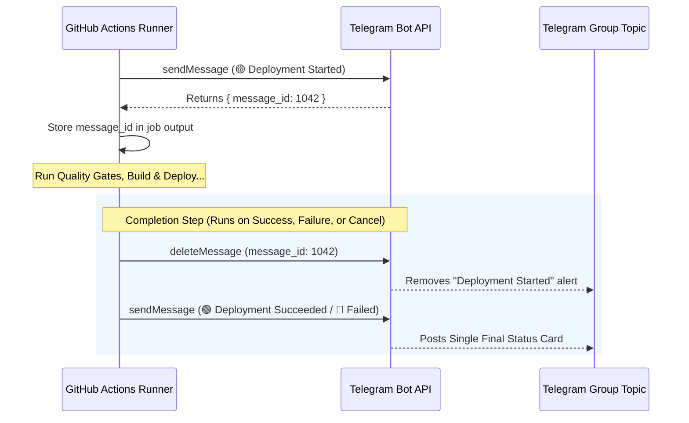

# Telegram Deployment Notifications Guide

This reference guide details the design, configuration, and implementation of automated deployment notifications using the official Telegram Bot API and GitHub Actions.

---

## 1. Notification Lifecycle Architecture

To prevent notification clutter in active developer chat groups and forum topics, this skill implements an atomic **Start-Delete-Replace** notification lifecycle:



### Why Delete-and-Replace?
- **Single Source of Truth:** A team member checking the deployment topic sees exactly one notification per run representing the final status.
- **Visual Clarity:** Replaces temporary in-progress alerts with a permanent summary card including commit details and direct GitHub Actions logs.
- **Clean History:** Avoids accumulating dozens of obsolete "Deployment started" messages.

---

## 2. Setting Up Your Telegram Bot & Topic

### Step 1: Create a Bot with @BotFather
1. Open Telegram and search for `@BotFather`.
2. Send `/newbot`.
3. Give your bot a friendly name (e.g., `Deploy Alerts Bot`) and a unique username ending in `bot` (e.g., `acme_deploy_bot`).
4. Copy the API token provided (e.g., `7123456789:AAFnk9...`). This is `TELEGRAM_BOT_TOKEN`.

### Step 2: Add Bot to Your Telegram Group
1. Open your team's Telegram group or supergroup.
2. Add your newly created bot as a member.
3. Promote the bot to **Administrator** and ensure it has:
   - ✅ **Post Messages**
   - ✅ **Delete Messages** (Mandatory for the notification lifecycle).

### Step 3: Retrieve `TELEGRAM_CHAT_ID`
1. Send a test message in the group: `hello bot`.
2. Open your browser and navigate to:
   ```
   https://api.telegram.org/bot<YOUR_TELEGRAM_BOT_TOKEN>/getUpdates
   ```
3. Look for the `"chat"` object in the JSON response:
   ```json
   "chat": {
     "id": -1001987654321,
     "title": "Engineering Team",
     "type": "supergroup"
   }
   ```
4. Copy the `id` (supergroup IDs always start with `-100`). This is `TELEGRAM_CHAT_ID`.

### Step 4: Retrieve `TELEGRAM_MESSAGE_THREAD_ID` (For Topics / Forums)
If your supergroup has **Topics** enabled and you want notifications routed to a dedicated `Deployments` topic:
1. Open Telegram Desktop or Telegram Web.
2. Right-click on the `Deployments` topic name and select **Copy Link**.
3. The copied link will look like:
   `https://t.me/c/1987654321/42`
4. The final number (`42`) is the `message_thread_id`. This is `TELEGRAM_MESSAGE_THREAD_ID`.
*(If you are sending notifications to a standard group without topics, leave `TELEGRAM_MESSAGE_THREAD_ID` empty).*

---

## 3. Formatting Standard: Why HTML Beats Markdown

Telegram supports two parsing modes: `MarkdownV2` and `HTML`.

### The Problem with MarkdownV2 in CI/CD:
`MarkdownV2` requires escaping 18 reserved characters: `_`, `*`, `[`, `]`, `(`, `)`, `~`, `\``, `>`, `#`, `+`, `-`, `=`, `|`, `{`, `}`, `.`, `!`.
Real-world Git commit messages frequently contain characters like:
- `fix(auth): update token parser [v1.2.0] - closes #14!`
If any single reserved character is not escaped, the Telegram API rejects the payload with HTTP 400: `Bad Request: can't parse entities in message text`. The notification fails completely.

### The HTML Solution:
In `HTML` mode, only 3 characters require escaping: `&` (`&amp;`), `<` (`&lt;`), and `>` (`&gt;`).
Our helper script escapes dynamic commit messages safely:
```bash
html_escape() {
  printf '%s' "$1" | sed -e 's/&/\&amp;/g' -e 's/</\&lt;/g' -e 's/>/\&gt;/g'
}
```

### Supported HTML Tags:
- `<b>Bold</b>`
- `<code>Inline Code</code>`
- `<pre>Code Block</pre>`
- `<a href="...">Link</a>`
- `<blockquote>Telegram Blockquote</blockquote>`

---

## 4. Message Templates & Styling Standards

The notification payload strictly follows the standard ForgeDocs Telegram card styling:

### A. Deployment Started Template:
```html
🚀 <b>Deployment Started</b>

<blockquote>
📦 <b>Repository:</b> <code>my-org/my-project</code>
🌿 <b>Branch:</b> <code>main</code> (production)
👤 <b>Triggered By:</b> octocat
📝 <b>Commit:</b> <code>a1b2c3d</code> — feat(auth): implement oauth login
</blockquote>

🔗 <a href="https://github.com/my-org/my-project/actions/runs/123456789"><b>View Actions Run #42 →</b></a>
```

### B. Deployment Successful Template:
```html
✅ <b>Deployment Successful</b>

<blockquote>
📦 <b>Repository:</b> <code>my-org/my-project</code>
🌿 <b>Branch:</b> <code>main</code> (production)
👤 <b>Triggered By:</b> octocat
📝 <b>Commit:</b> <code>a1b2c3d</code> — feat(auth): implement oauth login
⏱️ <b>Duration:</b> 1m 45s
</blockquote>

🔗 <a href="https://github.com/my-org/my-project/actions/runs/123456789"><b>View Actions Run #42 →</b></a>
```

### C. Deployment Failed Template:
```html
❌ <b>Deployment Failed</b>

<blockquote>
📦 <b>Repository:</b> <code>my-org/my-project</code>
🌿 <b>Branch:</b> <code>main</code> (production)
👤 <b>Triggered By:</b> octocat
📝 <b>Commit:</b> <code>a1b2c3d</code> — feat(auth): implement oauth login
⏱️ <b>Duration:</b> 48s
</blockquote>

🔗 <a href="https://github.com/my-org/my-project/actions/runs/123456789"><b>View Failure Logs #42 →</b></a>
```

### D. Deployment Cancelled Template:
```html
⚠️ <b>Deployment Cancelled</b>

<blockquote>
📦 <b>Repository:</b> <code>my-org/my-project</code>
🌿 <b>Branch:</b> <code>main</code> (production)
👤 <b>Triggered By:</b> octocat
📝 <b>Commit:</b> <code>a1b2c3d</code> — feat(auth): implement oauth login
⏱️ <b>Duration:</b> 12s
</blockquote>

🔗 <a href="https://github.com/my-org/my-project/actions/runs/123456789"><b>View Actions Run #42 →</b></a>
```

---

## 5. Reliability & Fault-Tolerance Guarantees

1. **Non-Blocking Execution:**
   All Telegram API calls are wrapped in error suppressors (`|| true`). If Telegram is experiencing an outage or the bot token is invalid, the actual deployment pipeline is NEVER failed or interrupted.
2. **Deletion Fallback:**
   If `deleteMessage` fails (e.g., message already deleted or bot lost permission), the completion step proceeds immediately to send the final status notification.
3. **Run on Cancellation:**
   The completion notification step is registered with `if: always()`, guaranteeing that even if a workflow is cancelled manually or fails on linting, the team is alerted.
